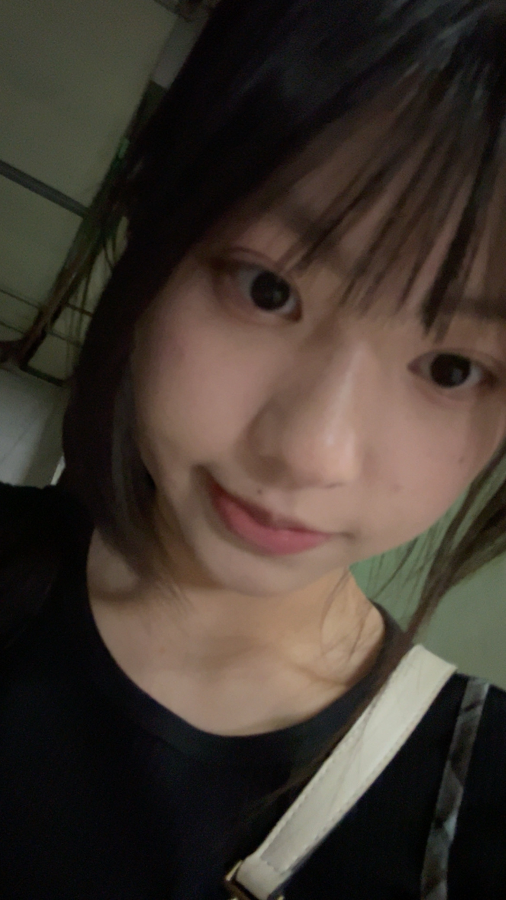
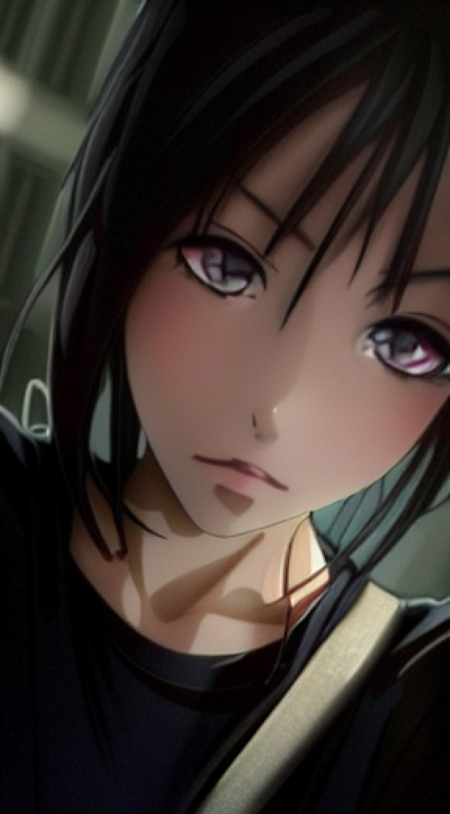
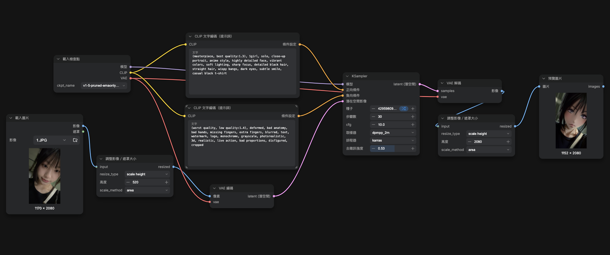

# comfyUI生成圖片：我的圖片
| 原始圖片 | 生成圖片 | 
|---|---|
|  |  |
## 完整工作流截圖

## 使用的正反提示詞
### 正提示詞：
```
(masterpiece, best quality:1.3), 1girl, solo, close-up portrait, anime style, highly detailed face, vibrant colors, soft lighting, sharp focus, detailed black hair, straight hair, wispy bangs, dark eyes, subtle smile, casual black t-shirt
```
### 反提示詞：
```
(worst quality, low quality:1.4), deformed, bad anatomy, bad hands, missing fingers, extra fingers, blurred, text, watermark, logo, monochrome, grayscale, photorealistic, 3d, realistic, live action, bad proportions, disfigured, cropped
```
## 個人心得
在這個過程中，需要自己下載v1-5-pruned-emaonly-fp16.safetensors模型，可是找不到資料夾在哪里，還有如何下載，後面製作圖的時候，發現圖片尺寸太大，會在執行過程中跑不動，所以要使用調整圖片大小的節點，且在後面還原圖片大小，才能跟原圖維持一樣的尺寸。也可以在KSampler調整步驟數、cfg和去雜訊強度，達到自己想要圖片。
